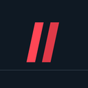

<div align="center">



# val//market

**Your Valorant store, without the game.**

A small desktop app that shows everything the in-game store has on rotation
for your account: daily skins, bundles, accessories, and the night market,
with real prices and a countdown to the next reset.

</div>

---

## The problem it solves

You want to know if today's rotation is worth logging in for. Opening VALORANT
takes a minute, and on a work laptop it's not even an option. val-market asks
Riot's own servers what's in your store, then gets out of the way.

## What it does

**Daily store** — the four rotating skin offers, each with its rarity tier,
price in VP, and a live countdown to the reset.

**Bundles** — every bundle currently on sale, with banner art, full contents,
per-item prices, and its own timer.

**Accessories** — gun buddies, player cards, sprays, and titles, priced in
Kingdom Credits.

**Night market** — discounted skins with the original price struck through
when the event is live, and an honest empty state when it isn't.

**Zero config** — no region picker. The app reads your shard from Riot and
corrects itself if Riot's answer doesn't match the store server.

## How sign-in works

You sign in on **Riot's own page**, inside a native window on desktop or your
system browser on mobile. Captcha, two-factor authentication, and platform
accounts (Google, Facebook, Apple, Xbox, PlayStation) all behave exactly like
they do in the real client.

This app never sees your password. Session tokens live in memory only and
die the moment you close the window. Nothing is stored, logged, or sent
anywhere except to Riot.

One store fetch per sign-in. No polling, no automation, no background
refresh.

## Platforms

| Platform | How to get it |
|---|---|
| macOS (Apple Silicon) | build locally, or download the `.dmg` from Releases |
| Windows | `.msi` installer via CI |
| Linux | `.deb`, `.rpm`, or AppImage via CI |
| Android | debug APK via CI |
| iOS | build locally with Xcode (needs an Apple Developer account for real devices) |

## Build it yourself

Prerequisites: Node.js, npm, and a Rust toolchain (`rustup.rs`).

```bash
npm install
npm run tauri dev      # run the app in development
npm run tauri build    # produce an installer
npm run verify         # logic self-check, no network needed
```

Continuous integration builds installers for every platform on version tags.
See `.github/workflows/release.yml`.

Android and iOS need their own toolchains: Android Studio + JDK 17, and
Xcode with an Apple Developer account respectively.

## Disclaimers

- Unofficial fan tool. Not affiliated with or endorsed by Riot Games.
- Valorant and all related properties are trademarks of Riot Games, Inc.
- Uses Riot's unofficial web endpoints. Automated access sits outside Riot's
  ToS, so the app fetches once per session and never automates anything.
- Store history is saved locally in your browser storage only.

## Docs

- [PRODUCT.md](PRODUCT.md) — users, purpose, positioning
- [DESIGN.md](DESIGN.md) — design system and tokens
- [docs/ARCHITECTURE.md](docs/ARCHITECTURE.md) — login flow, endpoints, security
- [docs/PLAN.md](docs/PLAN.md) — phases, decisions, risks
